# Diagrams — Visual Architecture Reference

This directory contains architecture diagrams in Mermaid format.
Render with any Mermaid-compatible viewer (GitHub, VS Code Mermaid plugin, Mermaid Live Editor).

---

## 1. System Overview

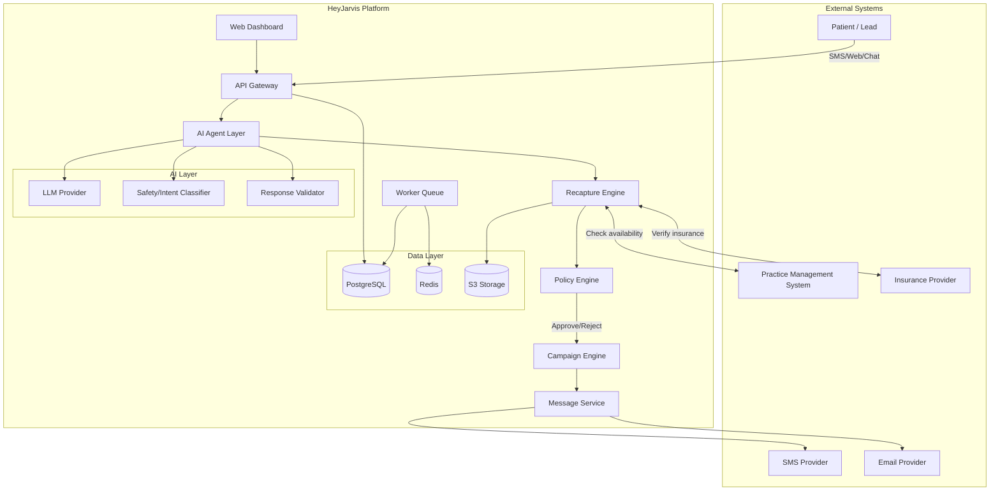

---

## 2. Patient State Machine

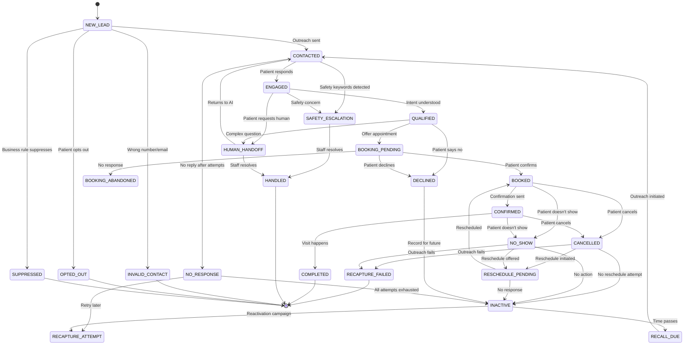

---

## 3. Event Flow Architecture

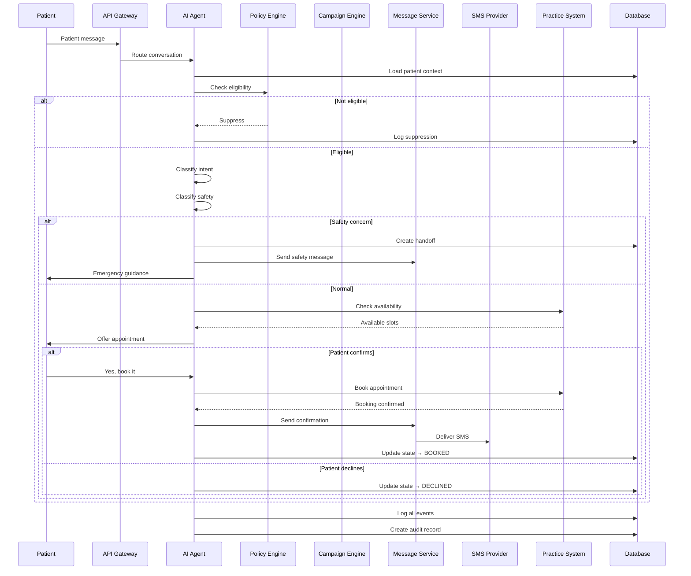

---

## 4. Database ERD

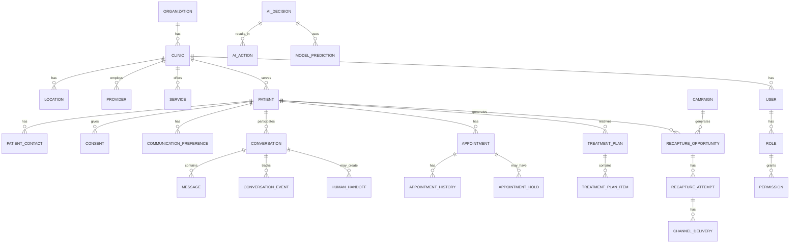

---

## 5. AI Decision Flow

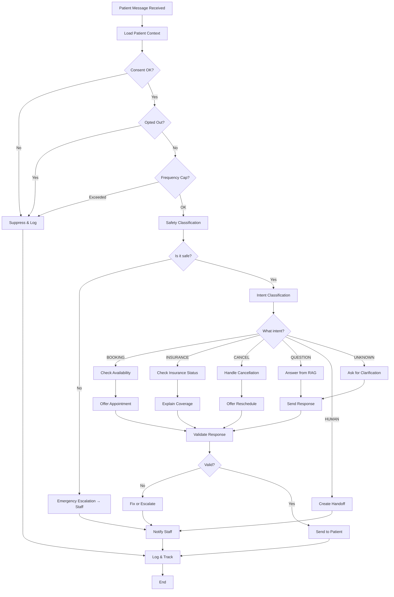

---

## 6. Deployment Architecture

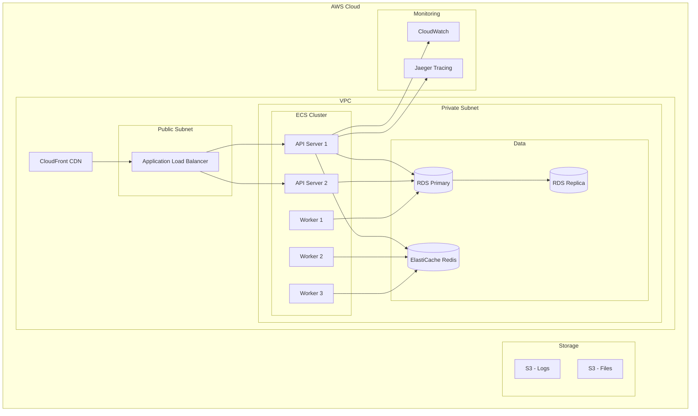

---

## 7. Message Campaign Flow

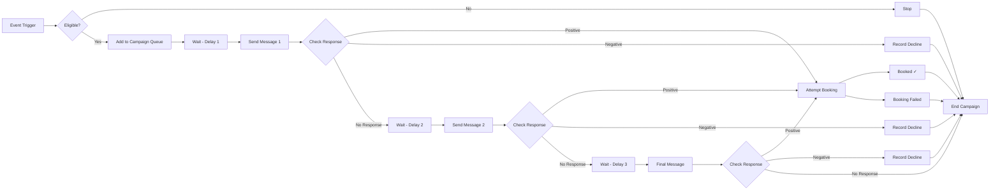

---

## 8. Data Flow for Booking

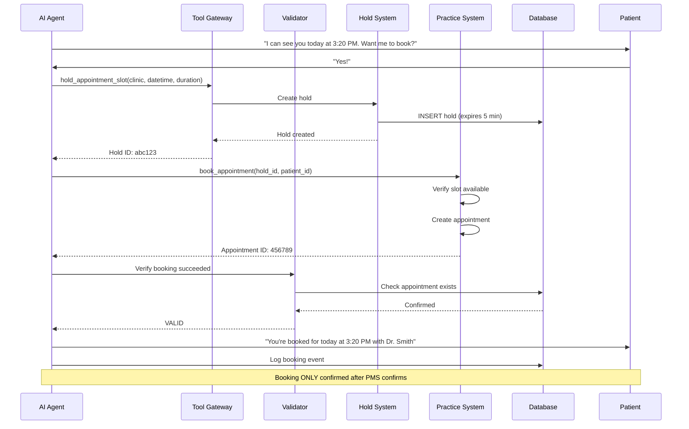

---

## 9. Multi-Tenant Data Isolation

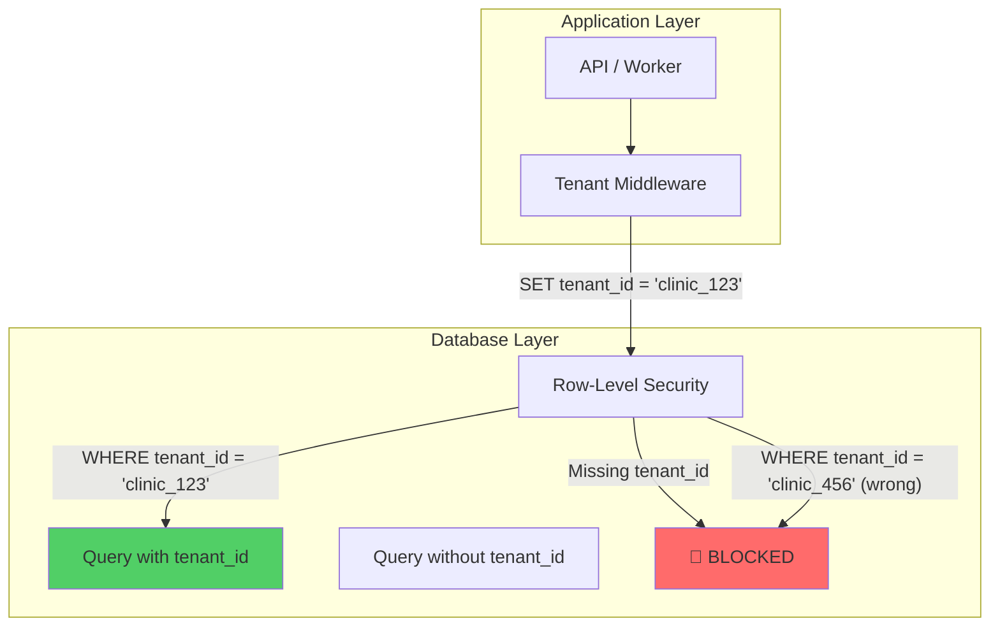

---

## 10. Observability Data Flow

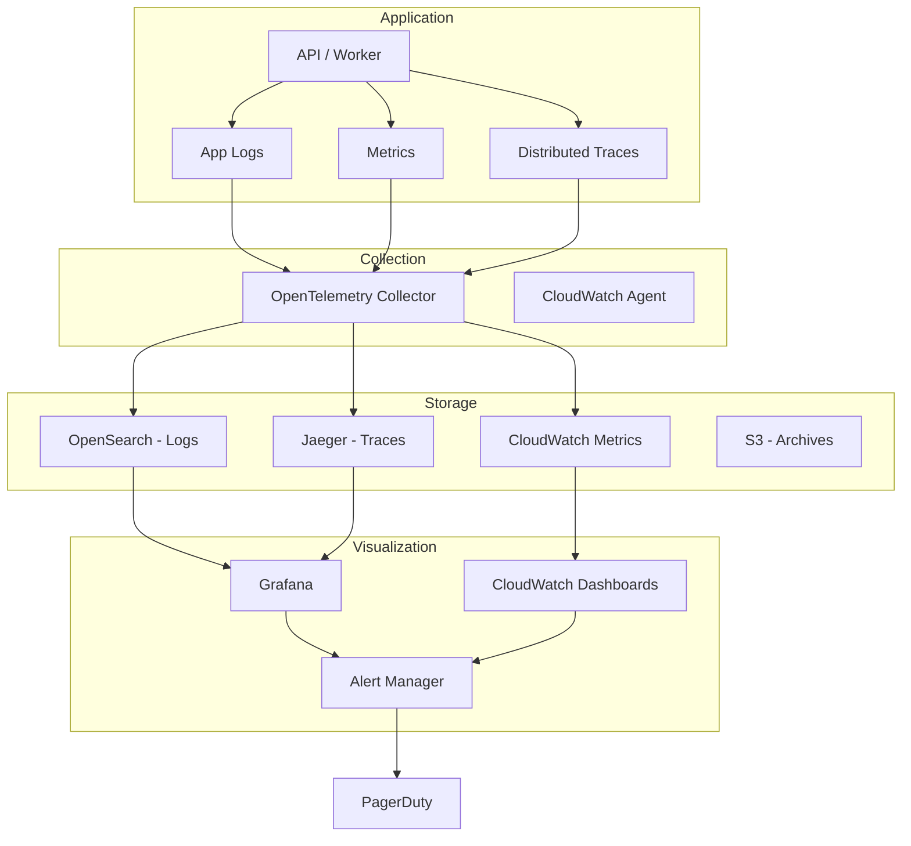

---

## 11. Patient Journey Map

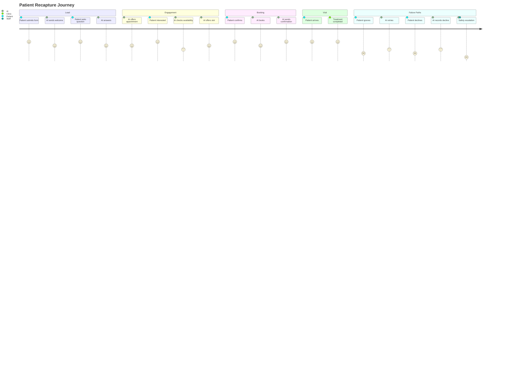

---

## 12. AI Accuracy Targets

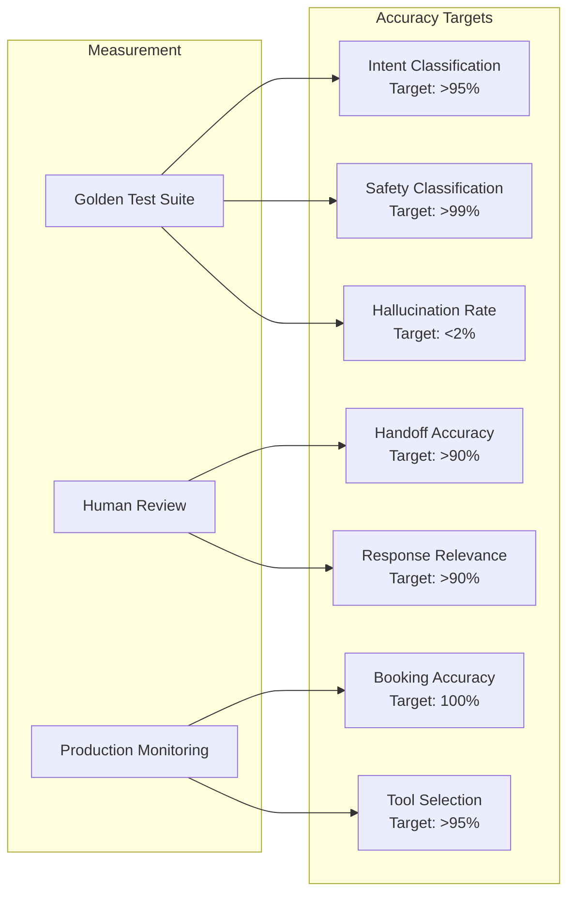
