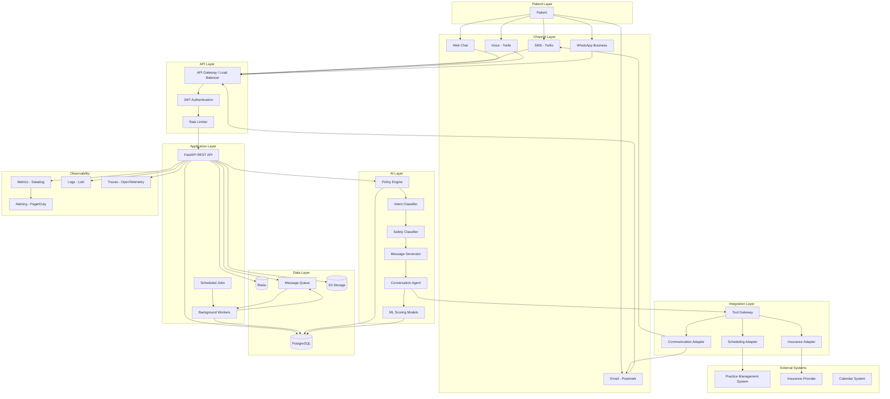
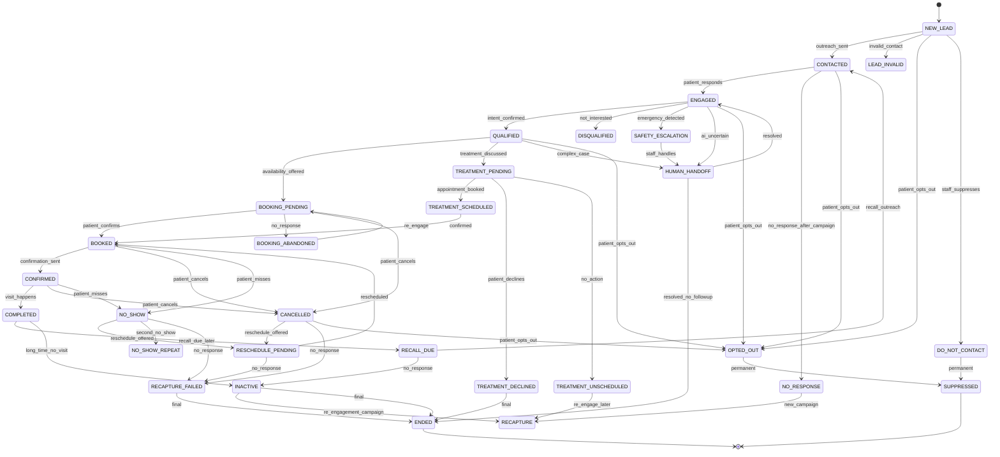
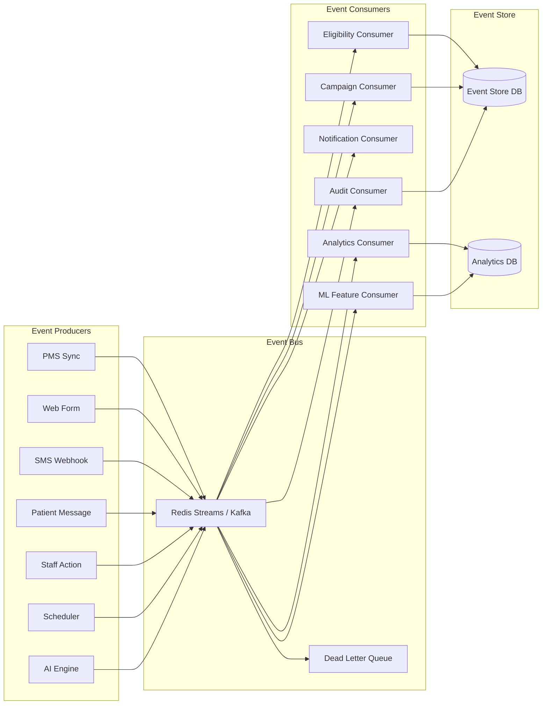
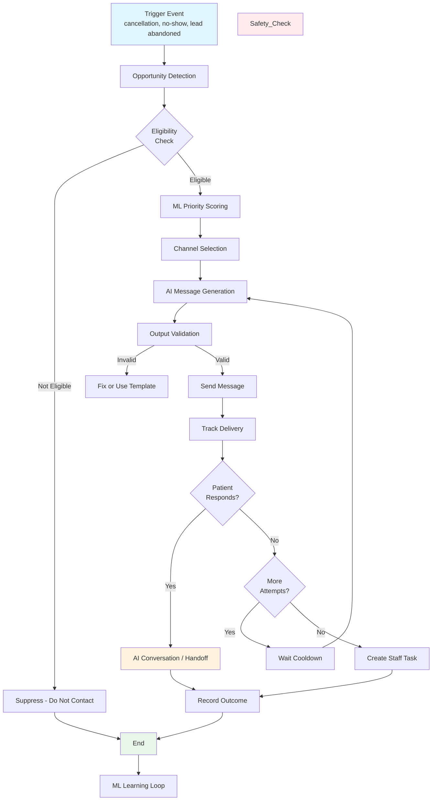
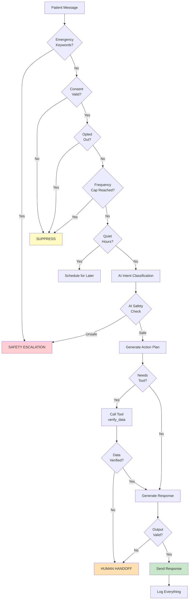
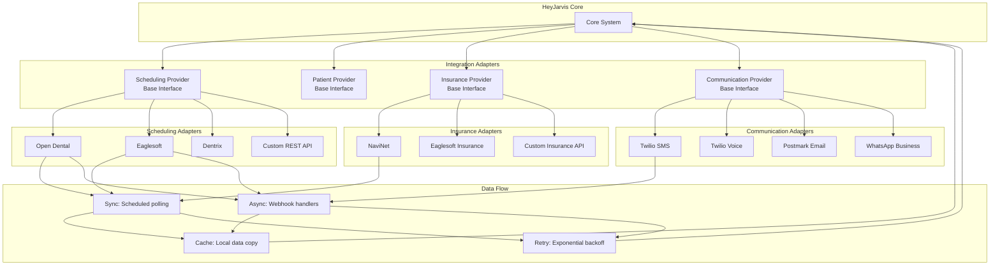
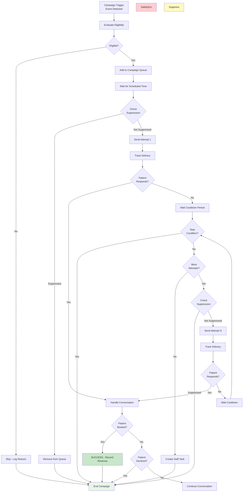
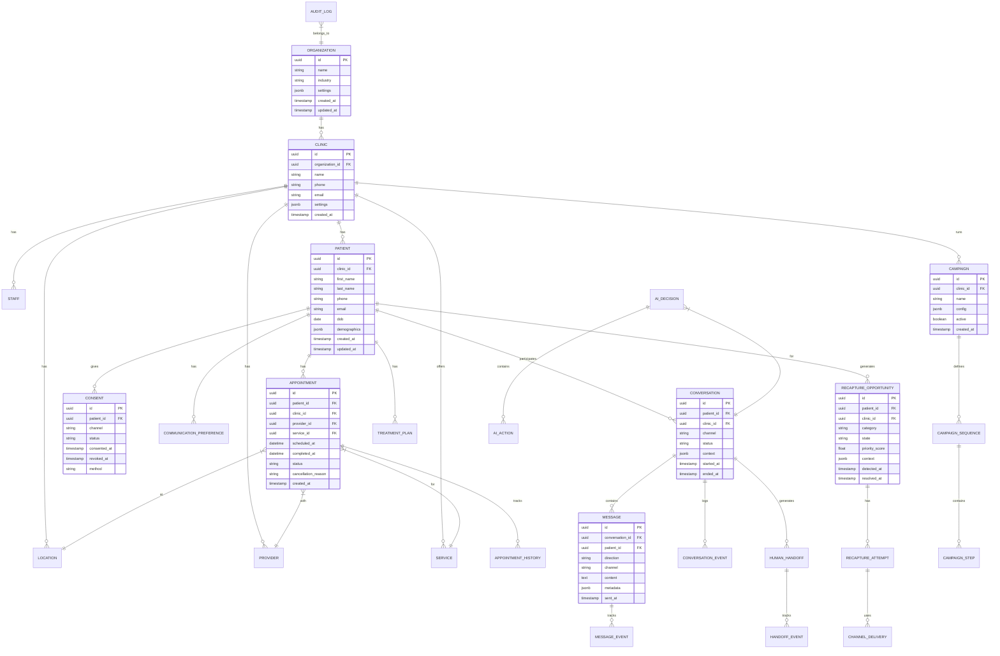
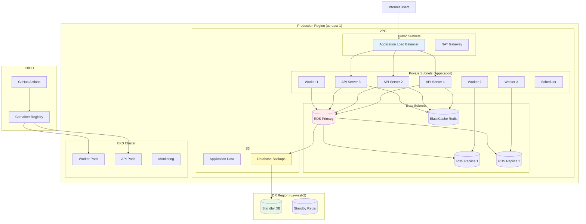

# Architecture Diagrams — Visual System Architecture

## AD.1 High-Level System Architecture



## AD.2 Patient Journey State Machine



## AD.3 Event Flow Architecture



## AD.4 Data Flow — Recapture Pipeline



## AD.5 AI Decision Flow



## AD.6 Multi-Tenant Data Architecture

```mermaid
graph TB
    subgraph "Tenant A - Dental Group X"
        TA_Clinic[Clinic A-1]
        TA_Patients[Patients]
        TA_Staff[Staff]
        TA_Config[Configuration]
    end

    subgraph "Tenant B - Dental Group Y"
        TB_Clinic[Clinic B-1]
        TB_Clinic2[Clinic B-2]
        TB_Patients[Patients]
        TB_Staff[Staff]
        TB_Config[Configuration]
    end

    subgraph "Tenant C - Single Practice"
        TC_Clinic[Clinic C-1]
        TC_Patients[Patients]
        TC_Staff[Staff]
        TC_Config[Configuration]
    end

    subgraph "Platform Layer (HeyJarvis)"
        API[API Layer<br/>Tenant from JWT]
        RLS[Row-Level Security]
        Encryption[Per-Tenant Encryption]
        RateLimit[Per-Tenant Rate Limits]
    end

    subgraph "Shared Infrastructure"
        DB[(PostgreSQL<br/>with RLS)]
        Cache[(Redis<br/>tenant-prefixed keys)]
        Queue[Message Queue<br/>tenant in message)]
        LLM[LLM Provider<br/>BAAs per tenant]
    end

    TA_Clinic --> API
    TA_Patients --> API
    TA_Staff --> API
    TA_Config --> API

    TB_Clinic --> API
    TB_Clinic2 --> API
    TB_Patients --> API
    TB_Staff --> API
    TB_Config --> API

    TC_Clinic --> API
    TC_Patients --> API
    TC_Staff --> API
    TC_Config --> API

    API --> RLS
    RLS --> Encryption
    Encryption --> RateLimit
    RateLimit --> DB
    RateLimit --> Cache
    RateLimit --> Queue
    RateLimit --> LLM

    style TA_Clinic fill:#e3f2fd
    style TB_Clinic fill:#f3e5f5
    style TC_Clinic fill:#e8f5e9
    style API fill:#fff3e0
    style RLS fill:#ffebee
```

## AD.7 Integration Architecture



## AD.8 Campaign Execution Flow



## AD.9 Database Entity Relationship



## AD.10 Deployment Architecture


